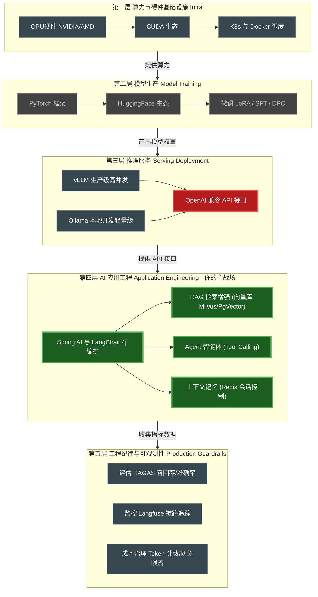
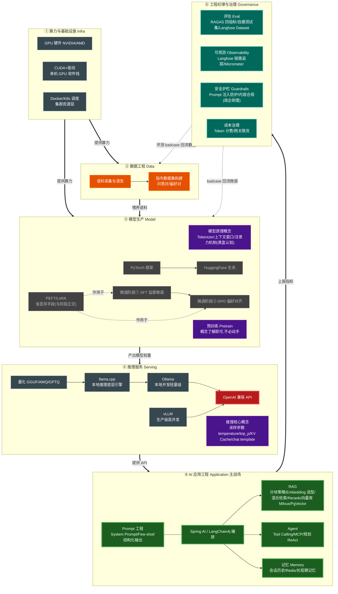

# AI学习路线图

---

# 修订版路线图 v2（2026-11-13 梳理）

> 原图保留在上面对照。本版修正原图 7 处问题，并按「学习 AI 整个流程、不深入算法」的目标补全缺口。
> 结构性变化：5 层 → 6 层（新增**数据工程层**），治理层增加**回流箭头**——AI 生产是闭环，不是单向管道。

## 修正后的全景图

## 与原图的修正对照

| # | 原图 | 修正为 | 原因 |
|---|------|--------|------|
| 1 | `GPU→CUDA→K8s` 串联 | 三节点并列，同属算力层 | CUDA 是单机软件栈，K8s 是集群调度层，二者不构成上下游依赖；K8s 通过 device plugin 分配 GPU 资源 |
| 2 | 无数据层 | 新增 L2 数据工程 | 数据是 AI 流程真正的起点，指令集质量决定微调上限（对应书第八章） |
| 3 | `微调 LoRA/SFT/DPO` 并列 | SFT→DPO 为阶段先后，LoRA 为正交的省显存方法 | LoRA 回答"怎么训省卡"，SFT/DPO 回答"训什么目标"，可组合（如 LoRA+SFT） |
| 4 | L3 只有 vLLM/Ollama/API 三个工具 | 补量化（GGUF/AWQ）、llama.cpp（Ollama 底层）、推理核心概念（采样参数/KV Cache/chat template） | 这层是"懂流程"的关键概念层，不是纯工具清单 |
| 5 | RAG = 向量库 | RAG 节点补技术本体：分块/Embedding/混合检索/Rerank | 向量库只是存储，检索质量由前四项决定 |
| 6 | Agent = Tool Calling | 补 MCP、ReAct 规划 | MCP 已成事实标准（Claude Code 即其最大落地） |
| 7 | RAGAS "召回率/准确率"，且无护栏 | 修正为 RAGAS 真实四指标，新增安全护栏节点 | RAGAS 指标是 Faithfulness/Answer Relevancy/Context Precision/Context Recall；政企交付中 Prompt 注入防护与内容合规是硬性要求 |

另有两处结构性变化：

- 治理层增加**回流箭头**（L6→L2/L3）：线上 badcase 与评测数据回流到数据集和微调，AI 工程是闭环
- 算力层同时指向数据与模型生产（原图只挂在训练之下）

## 各层学习深度（不深入算法版）

| 层 | 必须动手 | 概念理解即可 | 本仓库已有基础 |
|----|---------|-------------|---------------|
| ① 算力 | —（Docker/K8s 工作中天天用） | CUDA 与显存预算、量化与显存换算 | 工作经验覆盖；`p0_model/DownloadModel.py` 已练显存预算 |
| ② 数据 | 亲手构造一份 100 条指令对数据集 | 预训练语料规模、清洗去重流程 | 笔记：`p0_book/.../第八章：数据集工程.md` |
| ③ 模型 | 用 QLoRA 微调 Qwen2.5-0.5B/1.5B（8G 显存约束，**全参微调不可行**） | 预训练、注意力机制黑盒认知、DPO | `p2_pytorch/` 基础；`p0_model/` 下载与推理已通 |
| ④ 推理 | Ollama 部署、GGUF 量化转换、vLLM 起一次服务 | KV Cache、PagedAttention、量化位宽差异 | `p1_model_deploy/p1_ollama/note.md`、`p0_model/基础模型下载.md` |
| ⑤ 应用 | Spring AI 全链路：RAG/Tool Calling/Memory 各跑通一个 demo | Prompt 工程方法论、ReAct | `p3_rag/note.md` 已开写；书第一章 |
| ⑥ 治理 | Langfuse 接入 Spring AI 看到一条完整 trace；自建 20 条评测集 | RAGAS 四指标含义、限流策略 | 全新领域，从零起步 |

## 推荐路径：与其分层学，不如跑通一个贯通项目

分层学习容易停在"都懂一点"。建议用一个**政企客服问答小项目**把六层串起来，每步有验收标准：

1. **数据**：手工构造 100 条政务问答对（Excel → JSONL）→ 验收：能被 `datasets` 库加载
2. **微调**：QLoRA 微调 Qwen2.5-1.5B-Instruct → 验收：loss 下降，且回答比基座更贴合问答格式
3. **量化部署**：合并 LoRA 权重 → 转 GGUF → Ollama 跑通 → 验收：`ollama run` 出对话
4. **应用**：Spring AI 接 Ollama，叠加 RAG（知识库检索）+ Tool Calling（查工单）→ 验收：一个问题能同时触发检索和工具调用
5. **治理**：Langfuse 埋点 + 20 条评测集回归 → 验收：每次改 Prompt/参数，都能用评测集对比出分数变化

跑完这一圈，"AI 的整个流程"就从概念变成手感了。①层概念在过程中按需补课即可，不必单独开阶段。