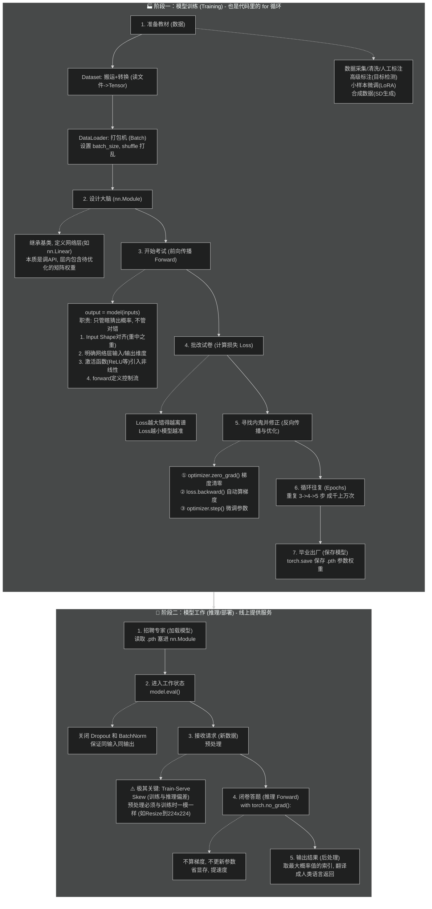

### 🏭 阶段一：模型是怎么“训练”出来的？（系统初始化与调参）

你可以把训练模型，想象成你在**训练一个刚入职的实习生（模型）**。

1. **准备教材（数据 - Dataset & DataLoader）**
   
   * 你得把历史数据（比如蚂蚁和蜜蜂的图片）拿过来。
     
     - 数据采集（照片，爬虫，人工采集，买数据）
     - 数据清洗（将没用的数据去掉）
     - 数据标注（机器不知道图片，数据是什么东西，例如照片，需要人工将对应照片与正确分类/答案进行关联）
     - 高级标注（如果不仅是分类，还要“框出手机在哪里”（目标检测），那还要用专门的工具（比如 LabelImg），人工在每张图上画个红框，框住手机。）
     - 小样本微调（Few-shot）：使用LoRA 微调一个视觉大模型，需要的样本量会比较少。
     - 合成数据（Synthetic Data）：用3D软件或者生成式AI（比如Stable Diffusion）凭空生成各种型号手机的图片，连拍照都省了。
   
   * `Dataset` 负责把照片和“标准答案（Label）”对上号。
     
     - 真正的核心能力是“搬运 + 转换”（在__getitem__里干的）。它不仅要知道文件在哪，还要负责把这个文件真正读到内存里，并且把它变成模型能吃的格式（比如把jpg变成张量Tensor）。
* `DataLoader` 负责把这些数据打包成一捆一捆的（Batch），比如一次喂4张图，让他学得快一点。
  - DataLoader 最大的作用，就是把零散的 (图片, Label) 拼装成矩阵，打包送给模型。
  - Dataset = 仓库的货架（只管拿货）。
    DataLoader = 自动打包机 + 物流传送带。它把拿出来的散装货，按你要求的数量（batch_size）装进纸箱，打乱顺序（shuffle），然后源源不断地向模型（你）发货。
2. **设计大脑（模型结构 - `nn.Module`）**
   * 你新建一个类，继承 `nn.Module`。
   * 你在里面定义一层一层的网络（全连接层、卷积层）。这就相当于规定了实习生大脑的神经元怎么连线。
     * `nn.Module` 就是你定制化模型的**基类（Base Class）**。
     * 实际上就是学会如何使用 pytorch 这些类库，知道各种API 的作用，实际上底层就是使用各种封装好的算法来优化定制自己的模型。
3. **开始考试（前向传播 - Forward）**
   * 你把一堆照片扔给模型：`output = model(inputs)`。
   * 模型会瞎猜一个结果给你（比如它猜这是个蜜蜂，输出一个数字 `0.8`）。
   * 前向传播的职责非常纯粹：数据进去，算出一堆概率（比如 `[0.2, 0.8]`），它的任务就结束了。
     * 前向传播说白了，在代码层面就是**“数据按顺序穿过你搭好的层”**。
     * **数据形状对齐（Input Shape）**，最重要，没有之一，
       * 数据进模型之前，必须是符合要求的张量（Tensor）。按照我的理解，就是终端与模型的交互需要遵守协议，这个协议就是入参的数据格式。这就跟Java里你把 `String` 强转成 `Integer` 会报错一样，**形状（Shape）对不上，前向传播直接完蛋**。你以后看报错，90%都是看形状。
     * **网络层（Layers）—— 就是黑盒函数**
       * 只需要知道两件事：**输入维度**和**输出维度**
       * 网络层（比如 `nn.Linear(256, 10)`）**不仅仅是转换数据格式，它里面是带着“参数（权重）”的！** 为什么输入 256 维，输出 10 维？因为里面有一个 `10 x 256` 的矩阵。数据进去，是跟这个矩阵做了矩阵乘法。**这些参数，就是模型在“循环往复”的过程中，不断被优化器微调的那个“内鬼”！** 你以后 `torch.save` 保存的模型文件，存的就是这些矩阵里的数字。
     * **激活函数（Activation）—— 引入非线性**
       * `ReLU`、`Sigmoid`、`Softmax`。
       * 知道为什么要用它。如果没有激活函数，你搭一万层网络，本质上也就是一次线性方程，模型根本学不会复杂的东西。`ReLU` 就是个过滤器（小于0的变0，大于0的不变）；最后分类通常用 `Softmax`（把输出转成概率，比如 `[0.1, 0.9]`，加起来等于1）。
     * **forward` 方法定义 —— 数据流的控制权**
       * 在 `nn.Module` 里重写的 `def forward(self, x):`。
       * 你要在这里面写清楚数据的流转路径。这就跟你在 Java 里写 `Controller -> Service -> Dao` 一样，你要在 `forward` 里明确写出 `x` 先过哪层，再过哪层。
     * **推理模式（`torch.no_grad()`）—— 工程落地必考**
       * 在模型预测（前向传播）时，必须加上 `with torch.no_grad():`
       * 训练的时候，前向传播需要保存中间结果为了反向传播算梯度。但如果你是在线上给用户提供服务（纯推理），不需要算梯度，也不更新参数。加上这句，能帮你**省下巨大的显存，提高推理速度**。这是你在做工程部署时必须要写的。

1. **批改试卷（计算损失 - Loss）**
   * 你拿它的猜测（0.8）和标准答案（Label，比如0）对比。
   * 用 `CrossEntropyLoss` 算出一个差距值（Loss）。**Loss越大，说明它错得越离谱。**

1. **寻找内鬼并修正（反向传播与优化 - Backward & Optimizer）**
   * 这是PyTorch最牛逼的地方！一句 `loss.backward()`，PyTorch会自动算出来，是模型里哪个参数（哪个神经元）导致了这个错误（算出梯度）。
   * 然后一句 `optimizer.step()`，优化器就会去微调那个参数，让它下次别犯这个错。
2. **循环往复（Epochs）**
   * 把上面 3、4、5 步重复成千上万次。模型内部的参数越来越准，Loss越来越小。
   * 严谨点说，是重复 **“前向传播(Forward) -> 计算损失(Loss) -> 梯度清零(Zero_grad) -> 反向传播(Backward) -> 更新参数(Step)”** 这几步。你漏了最不起眼但极其重要的“梯度清零”。（因为 PyTorch 的梯度默认会累加，如果不零，上一次的垃圾数据就会污染这一次的计算）。
3. **毕业出厂（保存模型）**
   * 训练完了，用 `torch.save` 把训练好的“参数权重（几十MB或者几个G的矩阵）”保存成一个 `.pth` 文件。

**（这就是训练！对应你的代码就是一个 `for` 循环！）**

---

### 阶段二：模型是怎么“工作”的？（线上推理/部署）

训练好的模型，就像一个学成归来的老专家。现在线上有个用户发了一张图，模型该怎么工作？

1. **招聘专家（加载模型）**
   
   - 你的系统启动时，读取那个 `.pth` 文件里的参数，塞进你定义好的 `nn.Module` 里。

2. **进入工作状态（`model.eval()`）**
   
   - 必须写这一句！告诉模型：“你现在是上班状态，不是训练状态，别乱动了”。
   - 模型里有一些“调皮”的层，比如 `Dropout`（训练时故意丢弃一些神经元防止死记硬背）和 `BatchNorm`。`eval()` 的本质，就是**把这些训练专用的层关掉**，让它们切换到测试的固定模式，保证你给同一个输入，每次输出的结果都是绝对确定的。

3. **接收请求（接收新数据）**
   
   - 用户发来一张新的照片。
   
   - 必须经过一堆预处理（Resize、转成Tensor、扔到显卡上）。**注意：这一步预处理必须和训练时一模一样，否则就是牛头不对马嘴！**
   
   - 很多新手自己训练了个模型，结果一上线，准确率暴跌，就是因为训练时图片缩放到 `224x224`，上线时忘了缩放，或者训练时图片转成了黑白，上线时传了彩色。在工程界，这叫 **Train-Serve Skew（训练与推理偏差）**。作为架构师，这是你必须要把控的。

4. **闭卷答题（推理 Forward - `torch.no_grad()`）**
   
   - 把新数据扔进模型：`output = model(new_input)`。
   
   - 必须在 `with torch.no_grad():` 下面运行。告诉PyTorch：“别算梯度了，咱们现在是干活，不是学习，省点显存和时间！”

5. **输出结果（后处理）**
   
   - 模型输出一堆概率（比如 `[0.2, 0.8]`）。
   
   - 你写代码取最大值的索引（1），把它翻译成“蜜蜂”，然后返回给用户。

