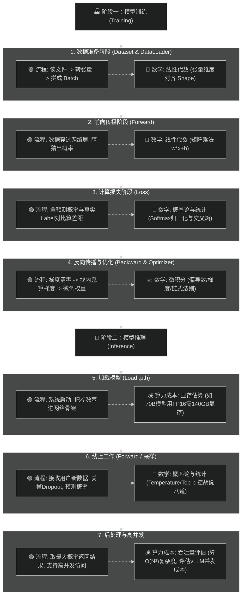

AI架构师（你未来的定位）需要的数学：

你不需要去发明算法，你需要的数学是**“算账”**！你需要知道在什么业务场景下，用什么模型能兼顾“准确率”和“成本”。  
**你的工作**：评估怎么让预测“工程上”落地。

你起步阶段绝对不要去碰高数，等你跑通了代码，开始搞大模型部署和微调的时候，你真正需要掌握的“架构师数学”只有下面这三个维度：

#### 1. 线性代数（Linear Algebra）—— 控制显存与形状的命脉

- **你要掌握的**：矩阵乘法、张量维度转换、点积。
  
- **工程应用**：你不需要手算矩阵。但你必须懂**“矩阵乘法的复杂度”**。为什么Transformer处理长文本特别吃显存？因为注意力机制里的矩阵乘法复杂度是 O(N2)（N是文本长度）。当你作为一个架构师，老板说“我们要支持100万字的长文档”，你脑子里立马要能算出显存会不会炸，需不需要换架构（比如用线性注意力或者RAG）。
  

#### 2. 概率论与统计（Probability & Statistics）—— 控制模型输出的阀门

- **你要掌握的**：正态分布、条件概率、Softmax（归一化）。
  
- **工程应用**：你现在知道模型输出的是概率对吧？如果你以后做大模型应用，用户抱怨“模型总爱胡说八道”，你作为架构师，你怎么调？你要懂**Temperature（温度参数）**和**Top-p（核采样）**。这俩参数的底层就是概率论。你要知道怎么通过调数学参数，让模型输出的概率分布变得“严谨”还是“发散”。
  

#### 3. 微积分（Calculus）—— 算Loss的基础

- **你要掌握的**：导数（变化率）、偏导数（梯度）。
  
- **工程应用**：你不需要手推链式法则（那是PyTorch底层干的）。但你需要知道**“梯度消失/梯度爆炸”**是什么概念。当你的Loss降不下去的时候，你作为架构师，你要有能力排查：是不是学习率设太大了？是不是网络太深导致梯度传不回去了？然后祭出对应的解决方案（比如加BatchNorm、调学习率）。
  

### 高阶架构师的终极数学：算力与成本评估（极其现实）

除了上面这三个，AI架构师最牛逼的数学能力是算**“资源和成本”**。

- **显存估算**：一个 70B（700亿参数）的模型，用 FP16（半精度，2个字节）加载，需要多少显存？70×109×2 bytes≈140 GB。这就是为什么你需要买 2 张 A100（每张80G）。
  
- **吞吐量评估**：并发100个用户，用 vLLM 跑，每秒钟能吐多少个字？成本多少钱？
  

如果你连这个都不会算，你去面试架构师，面试官直接让你滚蛋。这他妈全是数学，但这是**工程数学**。

