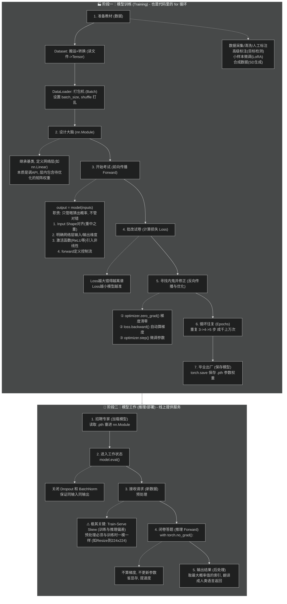
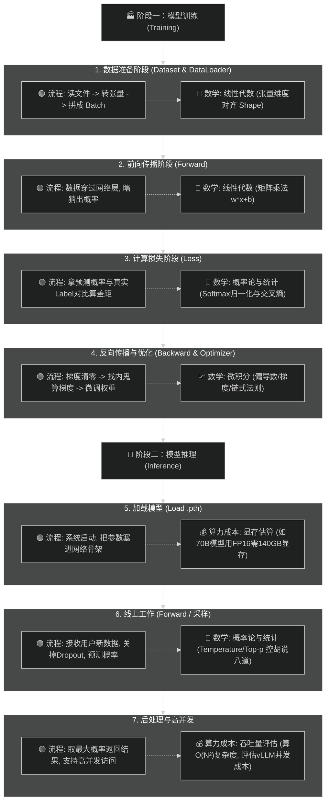
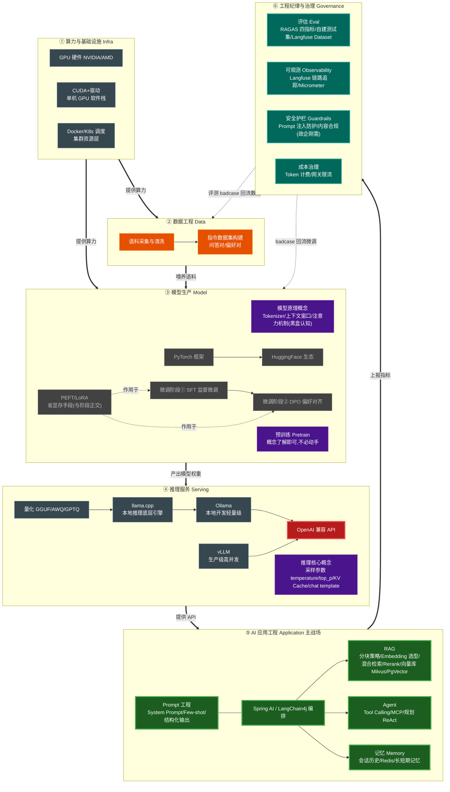

# ai-stack — 个人 AI 学习仓库

从 Python → PyTorch → 大模型应用工程的学习仓库。目录**按 AI 生产流程组织**：数据 → 微调 → 推理 → 应用 → 治理，每个层级对应流程的一环，产出是下一环的输入。

- 学习路线全景见本文 [第三章](#三ai-学习路线图)
- 先修概念见 [第一章](#一ai-是怎么工作的)（模型训练/推理流程）与 [第二章](#二ai-架构师需要什么能力)

## 目录导航

| 目录 | 内容 |
|---|---|
| `p0_book/` | 电子书资料（《AI工程：大模型应用开发实战》及笔记） |
| `p1_python_basic/` | 前置：Python 基础语法 |
| `p2_pytorch/` | 前置：PyTorch（数据集、训练流程） |
| [`p3_dataset/`](p3_dataset/) | ② 数据工程：语料清洗、指令对/偏好对构造 |
| [`p4_finetune/`](p4_finetune/) | ③ 模型微调：QLoRA SFT、LoRA 合并导出、DPO（选学） |
| [`p5_inference/`](p5_inference/) | ④ 推理服务：推理概念、Ollama、量化 GGUF、vLLM |
| [`p6_rag/`](p6_rag/) | ⑤ 应用·RAG：分块、Embedding、向量库、混合检索、Rerank |
| [`p7_agent/`](p7_agent/) | ⑤ 应用·Agent：Prompt、Tool Calling、MCP、Memory、Spring AI |
| [`p8_governance/`](p8_governance/) | ⑥ 治理：Langfuse 追踪、评测、护栏、Token 成本 |
| `main.py` | GPU 环境检测脚本（torch 版本 / CUDA / GPU 名） |

每个层级目录下有 `README.md` 说明该层定位、子目录作用与学习深度要求。

---

# 一、AI 是怎么工作的

> 用"训练一个刚入职的实习生"来理解模型的全生命周期。

## 阶段一：模型是怎么"训练"出来的（系统初始化与调参）

训练模型，本质是一个 `for` 循环，循环体是下面 7 步：

1. **准备教材（数据 - Dataset & DataLoader）**
   - 数据从哪来：采集（爬虫/人工/购买）、清洗（去掉脏数据）、标注（人工把数据和正确答案关联）、高级标注（目标检测要画框，用 LabelImg 等工具）、小样本微调（LoRA 微调大模型，样本量要求少）、合成数据（用 Stable Diffusion 等生成，连采集都省了）。
   - `Dataset` 负责"搬运 + 转换"：在 `__getitem__` 里把文件真正读进内存，并转成模型能吃的格式（jpg → Tensor）。它是仓库的货架，只管拿货。
   - `DataLoader` 是自动打包机 + 传送带：把零散的 (图片, Label) 按 `batch_size` 装箱、`shuffle` 打乱，源源不断发给模型。

2. **设计大脑（模型结构 - `nn.Module`）**
   - 新建类继承 `nn.Module`，在里面定义一层层网络（全连接层、卷积层），相当于规定实习生大脑的神经元怎么连线。
   - 本质是学会用 PyTorch 的类库与 API 来组装定制模型，底层是封装好的算法。

3. **开始考试（前向传播 - Forward）**
   - `output = model(inputs)`，模型瞎猜一个概率（比如 `[0.2, 0.8]`），前向传播的职责到此为止——只管算，不管对错。
   - **数据形状对齐（Input Shape），最重要，没有之一**：进模型前必须是符合要求的张量，跟 Java 里 `String` 强转 `Integer` 会报错一个道理，形状对不上前向传播直接完蛋。以后看报错，90% 先看形状。
   - **网络层（Layers）是带参数的黑盒函数**：只需关心输入/输出维度。`nn.Linear(256, 10)` 里面是一个 10×256 的权重矩阵，数据进去做矩阵乘法——这些参数就是被优化器不断微调的"内鬼"，`torch.save` 存的模型文件就是这些矩阵里的数字。
   - **激活函数引入非线性**：没有它，一万层网络也只是一次线性方程，学不会复杂东西。`ReLU` 是过滤器（负数归零），分类最后用 `Softmax` 把输出转成概率分布。
   - **`forward` 方法是数据流的控制权**：跟 Java 里 `Controller → Service → Dao` 一样，在 `forward` 里写清 x 先过哪层再过哪层。

4. **批改试卷（计算损失 - Loss）**
   - 拿预测和标准答案对比，`CrossEntropyLoss` 算出差距值。**Loss 越大，错得越离谱。**

5. **寻找内鬼并修正（反向传播与优化 - Backward & Optimizer）**
   - PyTorch 最强大的地方：`loss.backward()` 自动算出是哪些参数导致的错误（梯度），`optimizer.step()` 微调它们下次别再犯。
   - 严谨的循环体是：**前向传播 → 算 Loss → `optimizer.zero_grad()` 梯度清零 → `loss.backward()` → `optimizer.step()`**。梯度清零最不起眼但极其重要——PyTorch 梯度默认累加，不清零上一次的垃圾会污染本次计算。

6. **循环往复（Epochs）**
   - 把 3→5 步重复成千上万次，参数越来越准，Loss 越来越小。

7. **毕业出厂（保存模型）**
   - `torch.save` 把参数权重存成 `.pth` 文件（几十 MB 到几个 G 的矩阵）。

## 阶段二：模型是怎么"工作"的（线上推理/部署）

训练好的模型像学成的老专家，线上来了一张新图，工作流程 5 步：

1. **招聘专家（加载模型）**：系统启动时读取 `.pth` 参数，塞进定义好的 `nn.Module`。
2. **进入工作状态（`model.eval()`）**：必须写。把 Dropout、BatchNorm 这些"训练专用层"关掉，保证同样输入每次输出确定。
3. **接收请求（新数据预处理）**：Resize、转 Tensor、上显卡——**必须和训练时一模一样**。新手上线准确率暴跌，常见原因就是训练缩放 224×224、上线忘了缩放。工程上这叫 **Train-Serve Skew（训练与推理偏差）**，架构师必须把控。
4. **闭卷答题（`with torch.no_grad():`）**：线上是干活不是学习，不算梯度、不省着显存就是浪费。
5. **输出结果（后处理）**：取最大概率的索引，翻译成"蜜蜂"返回给用户。

---

# 二、AI 架构师需要什么能力

> 架构师不发明算法，架构师的数学是**"算账"**——知道什么业务场景用什么模型，能兼顾准确率与成本，把预测"工程上"落地。起步阶段不要碰高数，跑通代码、进入部署与微调阶段后，需要的是下面三个维度。

## 三个数学维度

### 1. 线性代数 —— 控制显存与形状的命脉

- **要掌握**：矩阵乘法、张量维度转换、点积
- **工程应用**：不用手算矩阵，但必须懂矩阵乘法的复杂度。为什么 Transformer 处理长文本特别吃显存？因为注意力机制的矩阵乘法复杂度是 O(N²)。老板说"要支持 100 万字长文档"，你要立刻能估出显存会不会炸、要不要换架构（线性注意力、RAG）

### 2. 概率论与统计 —— 控制模型输出的阀门

- **要掌握**：正态分布、条件概率、Softmax 归一化
- **工程应用**：模型输出的是概率，用户抱怨"总爱胡说八道"时，你要懂 **Temperature（温度）** 和 **Top-p（核采样）**——它们底层就是概率论。调这些参数，就是让输出分布变"严谨"或"发散"

### 3. 微积分 —— 算 Loss 的基础

- **要掌握**：导数（变化率）、偏导数（梯度）
- **工程应用**：不需要手推链式法则（PyTorch 底层干的），但要知道**梯度消失/梯度爆炸**是什么。Loss 降不下去时，能排查是学习率太大、还是网络太深梯度传不回去，再对症下药（加 BatchNorm、调学习率）

## 终极数学：算力与成本评估

架构师最值钱的数学能力是算**资源和成本**：

- **显存估算**：70B（700 亿参数）模型用 FP16（2 字节/参数）加载需要多少显存？70×10⁹×2 bytes ≈ **140 GB**——这就是要买 2 张 A100（80G/张）的原因
- **吞吐量评估**：并发 100 用户，vLLM 跑每秒吐多少字、成本多少钱

这些不是学术数学，是**工程数学**——架构师面试与方案评审的硬通货。

---

# 三、AI 学习路线图

> 目标：**学习 AI 的整个流程，不深入算法，但每层有一定深度**。结构：算力 → 数据 → 模型 → 推理 → 应用 → 治理六层；①算力不设目录（运维经验已覆盖），②~⑥ 对应 `p3_dataset` ~ `p8_governance`。

## 全景图（v2）

## 与初版路线图的修正对照

初版五层图（已归档于 git 历史）存在 7 处问题，修正如下：

| # | 初版 | 修正为 | 原因 |
|---|------|--------|------|
| 1 | `GPU→CUDA→K8s` 串联 | 三节点并列，同属算力层 | CUDA 是单机软件栈，K8s 是集群调度层，二者不构成上下游依赖；K8s 通过 device plugin 分配 GPU 资源 |
| 2 | 无数据层 | 新增 ② 数据工程 | 数据是 AI 流程真正的起点，指令集质量决定微调上限（对应书第八章） |
| 3 | `微调 LoRA/SFT/DPO` 并列 | SFT→DPO 为阶段先后，LoRA 为正交的省显存方法 | LoRA 回答"怎么训省卡"，SFT/DPO 回答"训什么目标"，可组合（如 LoRA+SFT） |
| 4 | 推理层只有 vLLM/Ollama/API 三个工具 | 补量化（GGUF/AWQ）、llama.cpp（Ollama 底层）、推理核心概念（采样参数/KV Cache/chat template） | 这层是"懂流程"的关键概念层，不是纯工具清单 |
| 5 | RAG = 向量库 | RAG 补技术本体：分块/Embedding/混合检索/Rerank | 向量库只是存储，检索质量由前四项决定 |
| 6 | Agent = Tool Calling | 补 MCP、ReAct 规划 | MCP 已成事实标准（Claude Code 即其最大落地） |
| 7 | RAGAS "召回率/准确率"，且无护栏 | 修正为 RAGAS 真实四指标，新增安全护栏节点 | RAGAS 指标是 Faithfulness/Answer Relevancy/Context Precision/Context Recall；政企交付中 Prompt 注入防护与内容合规是硬性要求 |

另有两处结构性变化：治理层增加**回流箭头**（线上 badcase 与评测数据回流数据集和微调，AI 工程是闭环）；算力层同时指向数据与模型生产。

## 各层学习深度（不深入算法版）

| 层 | 必须动手 | 概念理解即可 | 本仓库已有基础 |
|----|---------|-------------|---------------|
| ① 算力 | —（Docker/K8s 工作中天天用） | CUDA 与显存预算、量化与显存换算 | 工作经验覆盖；`p5_inference/p1_concepts/DownloadModel.py` 已练显存预算 |
| ② 数据 | 亲手构造一份 100 条指令对数据集 | 预训练语料规模、清洗去重流程 | 笔记：`p0_book/.../第八章：数据集工程.md` |
| ③ 模型 | 用 QLoRA 微调 Qwen2.5-0.5B/1.5B（8G 显存约束，**全参微调不可行**） | 预训练、注意力机制黑盒认知、DPO | `p2_pytorch/` 基础；`p5_inference/p1_concepts/` 下载与推理已通 |
| ④ 推理 | Ollama 部署、GGUF 量化转换、vLLM 起一次服务 | KV Cache、PagedAttention、量化位宽差异 | `p5_inference/p2_ollama/note.md`、`p5_inference/p3_quantize/基础模型下载.md` |
| ⑤ 应用 | Spring AI 全链路：RAG/Tool Calling/Memory 各跑通一个 demo | Prompt 工程方法论、ReAct | `p6_rag/note.md` 已开写；书第一章 |
| ⑥ 治理 | Langfuse 接入 Spring AI 看到一条完整 trace；自建 20 条评测集 | RAGAS 四指标含义、限流策略 | 全新领域，从零起步 |

## 推荐路径：与其分层学，不如跑通一个贯通项目

分层学习容易停在"都懂一点"。建议用一个**政企客服问答小项目**把六层串起来，每步有验收标准：

1. **数据**：手工构造 100 条政务问答对（Excel → JSONL）→ 验收：能被 `datasets` 库加载
2. **微调**：QLoRA 微调 Qwen2.5-1.5B-Instruct → 验收：loss 下降，且回答比基座更贴合问答格式
3. **量化部署**：合并 LoRA 权重 → 转 GGUF → Ollama 跑通 → 验收：`ollama run` 出对话
4. **应用**：Spring AI 接 Ollama，叠加 RAG（知识库检索）+ Tool Calling（查工单）→ 验收：一个问题能同时触发检索和工具调用
5. **治理**：Langfuse 埋点 + 20 条评测集回归 → 验收：每次改 Prompt/参数，都能用评测集对比出分数变化

跑完这一圈，"AI 的整个流程"就从概念变成手感了。①层概念在过程中按需补课即可，不必单独开阶段。
