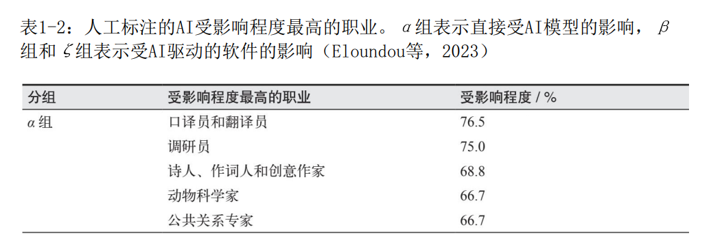
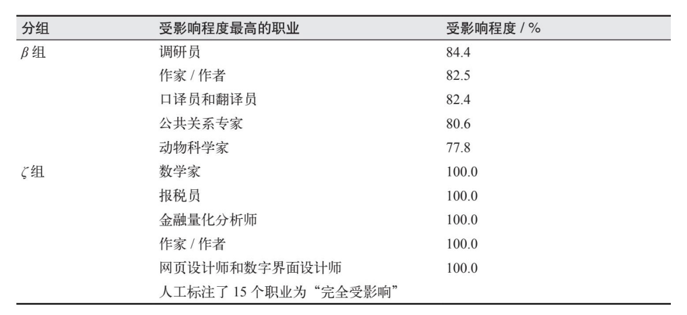
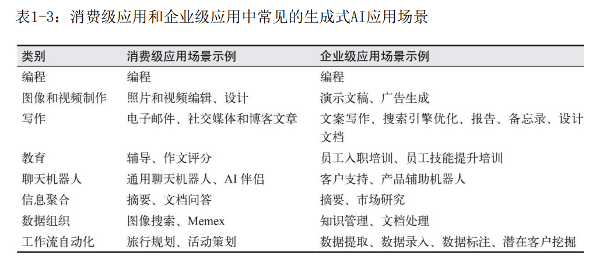
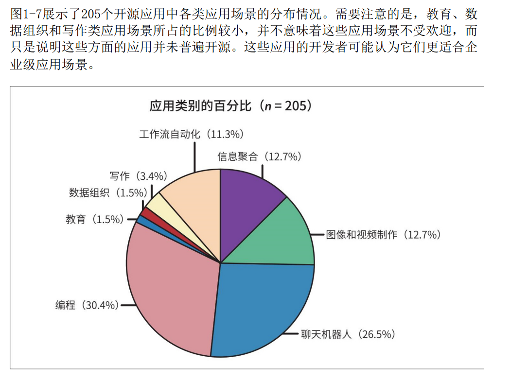
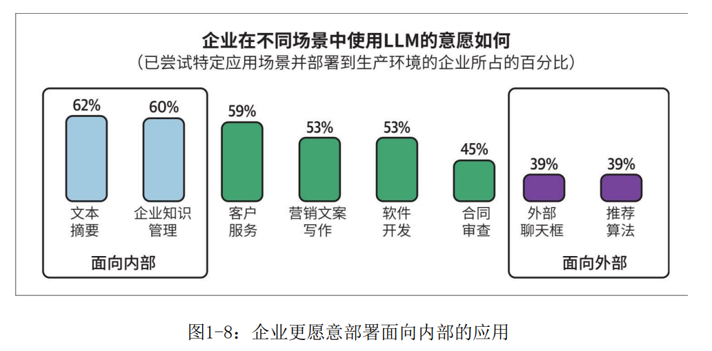
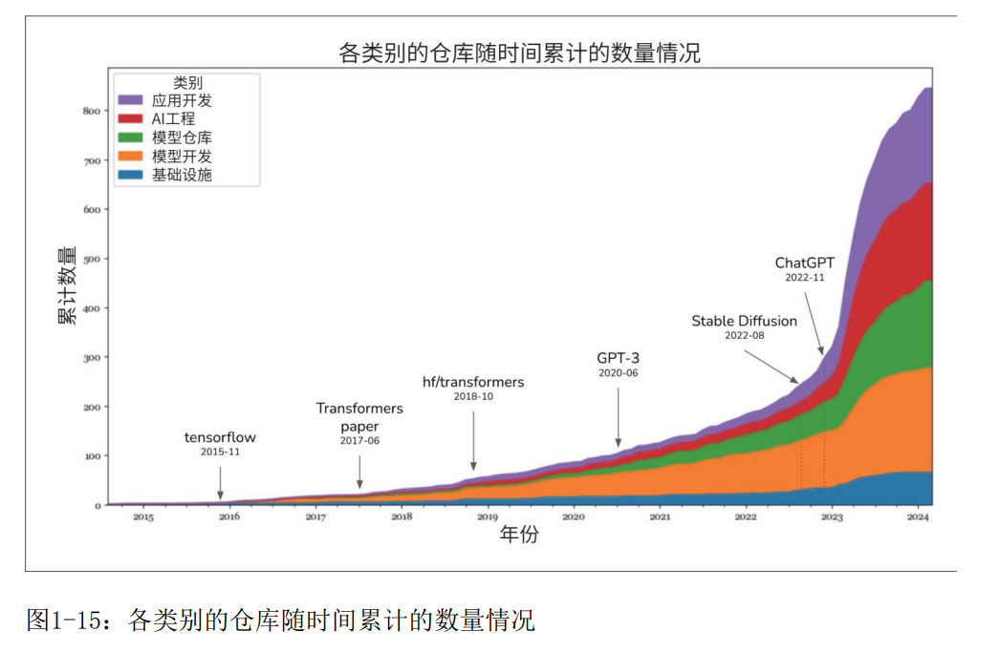
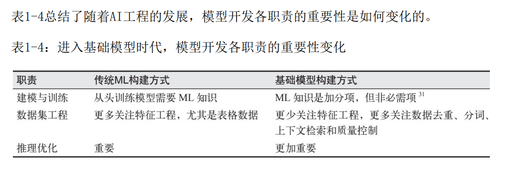
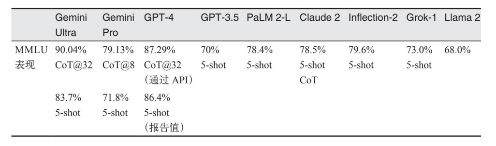

# AI 工程：大模型应用开发实战

# 第一章：基于基础模型构建AI应用入门

基础模型源自大语言模型，而大语言模型最初只是普通的语言模型。

尽管语言模型已经存在了一段时间，但没有自监督方法的出现，它们就无法发展到
今天的规模。本节将简要介绍语言模型和自监督的含义。如果你已经熟悉这些内
容，可以跳过。

# 1.1 AI工程的兴起

## 1.1.1 从语言模型到大预言模型

### 1. 语言模型

语言模型对一种或多种语言的统计信息进行编码。直观地说，这些信息告诉我们一
个词在特定上下文中出现的可能性。例如，给定上下文“My favorite color is
_____”（我最喜欢的颜色是____），一个英语语言模型预测blue（蓝色）出现的
可能性比car（车）更大。

根据模型的不同 ，一个token可以是一个字
符、一个单词，或者一个单词的一部分（例如-tion）。例如，ChatGPT背后的模型
GPT-4将短句“I can't wait to build awesome AI applications”（我等不及创
建超棒的AI应用了）分成了9个token，如图1-1所示。注意，在这个例子中，单词
can't被分成了两个token：can和't。你可以在OpenAI的网站上查看不同OpenAI模
型如何对文本进行分词。

将原始文本拆分成token的过程称为分词（tokenization）。

模型能够处理的所有token的集合称为模型的词表（vocabulary）。你可以用少量
的token构建大量不同的单词，这类似于用字母表中的字母构建许多单词。Mixtral
8x7B模型的词表大小为32,000个token，GPT-4的词表大小为100,256个token。分词
方法和词表大小由模型开发者决定。

为什么语言模型以token，而不是单词或字符为单位？主要有以下三个原因。

1. 与字符相比，token允许模型将单词拆分为有意义的组成部分。例如，cooking
   可以拆分为cook和ing，这两个部分都携带了原单词的一些含义。
2. 因为token数比单词数少，这减小了模型的词表，使模型更加高效（第2章会讨
   论）。
3. token还能帮助模型处理未知单词。例如，一个虚构的单词chatgpting可以拆分
   为chatgpt和ing，帮助模型理解其结构。token在数量上比单词少，同时又比单个
   字符携带更多的含义，实现了二者之间的平衡。

语言模型主要有两种类型：掩码语言模型（masked language model）和自回归语
言模型（autoregressive language model）。它们的区别在于预测一个token时所
能使用的信息。

#### 掩码语言模型

掩码语言模型通过上下文信息（即缺失token前后的内容）来预测序列中任意位置
缺失的token。本质上，掩码语言模型的训练目标就是填空。例如，给定上下文
“My favorite _____ is blue”（我最喜欢的_____是蓝色），掩码语言模型应预
测空白处最可能的词是color。一个著名的掩码语言模型示例是BERT
（bidirectional encoder representations from transformers，基于
Transformer的双向编码器表示），参见Devlin等在2018年发表的论文“BERT:
Pre-training of Deep Bidirectional Transformers for Language
Understanding”。

截至本书撰写时，掩码语言模型通常用于情感分析和文本分类等非生成任务。它们
也适用于需要理解整体上下文的任务，例如代码调试，这类任务要求模型同时理解
代码前后的内容以识别错误。

#### 自回归语言模型

自回归语言模型仅利用前序token来预测序列中的下一个token。例如，它会预测
“My favorite color is _____”中空白处接下来可能出现的token。 自回归语
言模型可以连续地逐个生成token。目前，自回归语言模型是文本生成任务的首选
模型，因此比掩码语言模型更受欢迎。

语言模型的输出是开放式的。语言模型可以利用其固定且有限的词表，构建出无限
种可能的输出。

你可以将语言模型看作一种补全机器：给定一段文本（提示词），它会尝试补全该
文本。以下是一个示例。

提示词（来自用户）：To be or not to be

补全（来自语言模型）：，that is the question.

需要注意的是，补全结果是基于概率的预测，并不能保证正确。这种语言模型的概
率特性让人们在实际使用过程中既爱又恨。

虽然补全功能很强大，但补全并不等同于进行对话。例如，你向一台补全机器提出
问题，它可能会通过添加另一个问题来补全你的话，而不是回答你的问题。2.3节
将讨论如何让模型适当地回应用户的请求。

### 2.自监督

为什么语言模型可以在众多 ML 模型中脱颖而出？

因为语言模型可以使用自监督方法来进行训练，自监督就是不需要数据标注来进行训练。而数据标注是模型训练最耗费时间成本的一个过程。

## 1.1.2 从大语言模型到基础模型

尽管语言模型能够完成令人惊叹的任务，但它们的能力仅限于文本。作为人类，我
们不仅通过语言文字，还通过视觉、听觉、触觉来感知世界。AI要在现实世界中发
挥作用，处理文本之外的数据是必不可少的。

尽管许多人仍然将Gemini和GPT-4V称为LLM，但对其更准确的称呼应是基础模型
（Bommasani等，“On the Opportunities and Risks of Foundation Models”，
2021）。基础一词体现了这些模型在AI应用中的重要性，也表明了可以将它们作为
基础，进一步构建以满足不同的需求。

基础模型的突破在于，不用拘束于只处理一种特定的一种数据，它能够处理多种数据模态的模型，称为多模态模型（multimodal model）。

基础模型也标志着从特定任务模型向通用模型的转变。过去，模型通常是针对特定
任务开发的，比如情感分析或翻译。一个为情感分析训练的模型无法进行翻译任
务，反之亦然。

而基础模型由于其规模和训练方式，能够胜任广泛的任务。通用模型在未经调整
的情况下，就能较好地完成许多任务。例如，LLM既能做情感分析，也能做翻译。
不过，通常可以对通用模型进行微调，使其在特定任务上的表现最优。

你可以使用多种技术来引导模型生成你想要的内容。例如，你可以精心设计详细
的指令，并提供理想的产品描述示例，这种方法称为提示工程。你还可以将模型
连接到客户评论数据库，让模型利用这些信息生成更好的描述。这种利用数据库
补充指令的方法称为检索增强生成（RAG）。此外，你也可以在高质量的产品描
述数据集上对模型进行进一步训练，即微调。

## 1.1.3 从基础模型到AI工程

AI工程是指在基础模型之上构建应用的过程。人们构建AI应用的历史已经超过10年
了——这一过程通常被称为ML工程或MLOps（ML operations，机器学习运维）。那
么，为什么我们现在要谈论AI工程呢？

如果说传统ML工程是围绕“开发ML模型”展开的，那么AI工程则是围绕“利用已有
模型”来构建应用。强大的基础模型变得易于获取和使用，推动了以下三个关键因
素的形成，三者共同为AI工程这一新兴学科的快速发展创造了理想条件。

### 因素1：通用的AI能力

基础模型的强大之处不仅在于它们能更好地完成现有任务，还在于它们能胜任更多
任务。过去认为不可能实现的应用现在已成为可能，以前未曾想到的应用如今也开
始涌现，甚至今天认为不可能的应用，明天也可能成为现实。这使得AI覆盖了更多
生活场景，也促使AI应用的用户群和需求大幅增长。

### 因素2：AI投资的增加

### 因素3：构建AI应用的门槛降低

由OpenAI和其他模型提供商推广的模型即服务方式，使得利用AI构建应用变得更加
容易。在这种方式下，模型通过API对外提供服务，接收用户请求并返回模型输
出。如果没有这些API，使用AI模型就需要自行搭建基础设施来托管模型和提供服
务。而现在，你只需通过简单的API调用就能使用强大的模型。

不仅如此，AI还使得以极少的代码构建应用成为可能。首先，AI可以为你编写代
码，让没有软件工程背景的人也能快速将想法转化为代码，并呈现给用户。其
次，你可以直接用自然语言与这些模型交互，而无须使用编程语言。现在，任何
人——我是说任何人——都可以开发AI应用。

## 1.2 基础模型的应用场景

## 1.3 规划AI应用

或许应该停下来思考一下：你为什么要构建这个应用？
应该如何着手？利用基础模型做一个炫酷的演示很容易，但要打造一个盈利的产品
却很难。

### 1.3.1 应用场景评估

首先要问的是：你为什么想要构建这个应用？和许多商业决策一样，构建AI应用通
常是对风险和机遇的一种回应。以下是一些不同风险级别的示例，按风险从高到低
排列。

**如果不这样做，拥有AI的竞争对手可能会淘汰你。**

**如果不这样做，就会错失提升利润和生产力的机会。**

**你可能还不确定AI如何融入你的业务，但也不想被时代抛下。**

#### 1. AI与人在应用中的角色

AI在产品中所扮演的角色决定了应用的开发方式及其需求。苹果公司提供了一份出
色的文档，阐述了AI在产品中的不同应用方式 *参见苹果开发者网站“人机界面指
南”（Human Interface Guidelines）中“机器学习”（Machine learning）部
分。* 以下是与当前讨论相关的三个关键点。

#### 关键性与辅助性

如果一个应用在没有AI的情况下仍然可以运行，那么AI对该应用而言就是辅助性
的。例如，Face ID如果没有AI驱动的人脸识别功能就无法运行，而Gmail即使没有
智能撰写（Smart Compose）功能也仍然可以使用。

AI对应用越关键，用户对AI的准确性和可靠性的要求就越高。当AI并非应用的核心
功能时，用户对AI犯错的容忍度通常会更高。

#### 被动式与主动式

被动式功能是在用户请求或进行特定操作后才做出响应，而主动式功能则是在有机
会时主动提供响应。例如，聊天机器人属于被动式功能，而Google地图的交通提醒
则属于主动式功能。

由于被动式功能是针对事件做出的响应，因此通常（但并非总是）需要快速反应。
另一方面，主动式功能可以提前计算并在适当时机展示，因此对延迟的敏感度较低。

由于用户并未主动请求，如果主动式功能的质量较差，用户可能会觉得这些功能具
有侵入性或令人厌烦。因此，主动式预测和生成通常对质量有更高的要求。

#### 动态与静态

动态功能会根据用户反馈持续更新，而静态功能则是定期更新。例如，Face ID需
要随着用户面部随时间变化而不断更新。然而，Google相册中的物体检测功能可能
只在软件升级时才会更新。

在AI的情境下，动态特性可能意味着每个用户拥有自己的模型，模型持续根据用户
数据进行微调，或者采用其他个性化机制，例如ChatGPT的记忆功能，使其能够记
住每个用户的偏好。而静态特性可能是多个用户共享一个模型，在这种情况下，只
有在共享模型更新时，功能才会更新。

此外，明确人在应用中的角色也很重要。AI是为人类提供后台支持，还是直接做出
决策，抑或两者兼而有之？

将人类纳入AI决策过程的方式称为人在回路（human-in-the-loop）。

#### 2. AI产品的防御性

如果你将AI应用作为独立产品进行销售，那么考虑产品的防御性就非常重要。低门
槛既是福也是祸：如果你很容易就开发出了某个产品，那么你的竞争对手同样容易
复制。你有哪些护城河可以用来保护你的产品？

从某种意义上说，在基础模型之上构建应用意味着你在这些模型之上提供了一个额
外的层。 这也意味着，如果底层模型的能力不断扩展，你所提供的这一层可能
会被模型本身所取代，从而使你的应用过时。举个例子，假设你基于ChatGPT构建
了一个PDF解析应用，前提是ChatGPT无法很好地解析PDF，或者无法大规模地解析
PDF。一旦这个前提不再成立，你的竞争力就会减弱。当然，即使在这种情况下，
如果你的PDF解析应用是基于开源模型构建的，并且面向那些希望内部托管模型的
用户，那么这个应用依然可能有意义。

一家大型风险投资公司的普通合伙人告诉我，她见过许多初创公司的整个产品其实
都可以成为Google文档或Microsoft 365中的一个功能。如果这些产品真的火了，
谷歌或微软只需安排三名工程师，用两周时间就能复制出来，那么这些初创公司又
该如何应对？

在AI领域，竞争优势一般有三种：技术、数据和分发（将产品推向用户的能力）。
在基础模型时代，大多数公司的核心技术非常相似，而分发优势则很可能属于大公
司。

数据优势的情况则更加微妙。大公司可能拥有更多现成的数据。然而，如果一家初
创公司能够率先进入市场，并收集足够的使用数据来持续改进产品，那么数据将成
为它的护城河。即使在某些情况下用户数据无法直接用于训练模型，使用信息也能
提供关于用户行为和产品缺陷的宝贵洞察，从而指导数据收集和训练过程。 

很多初创公司最终超越了体量更大的竞争对手，而它们的起点往往是开发那些被大
公司忽视的功能。也许你的产品会成为下一个这样的例子。

#### 1.3.2 设定目标

一旦你决定要自己构建一个出色的AI应用，下一步就是明确目标：你将如何衡量成
功？最重要的指标是它将如何影响你的业务。例如，你要构建一个客服机器人，业
务指标可以包括以下内容。

- 你希望聊天机器人自动处理客户消息的比例是多少？
- 聊天机器人应该帮助你多处理多少消息？
- 使用聊天机器人后，你的响应速度能提高多少？
- 聊天机器人能为你节省多少人力成本？

聊天机器人能够回复更多消息，但这并不意味着用户一定会满意，因此追踪用户满
意度和反馈非常重要。10.2节将讨论如何设计反馈系统。

为了确保产品准备充分后再呈现给用户，需要明确界定产品的实用性门槛，即产品
必须达到怎样的表现才算实用。实用性门槛可能包括以下几类指标。

- 质量指标：衡量聊天机器人回复的质量。
- 延迟指标：包括TTFT（time to first token，首个token响应时间）、TPOT
（time per output token，每个输出token响应时间）和总延迟。什么样的延迟是
可接受的，取决于具体的应用场景。如果当前所有用户请求都由人工处理，中位响
应时间为1小时，那么只要AI的响应比1小时快，可能就算足够好。
- 成本指标：每次推理请求的成本。
- 其他指标：例如可解释性和公平性。

如果你还不确定要使用哪些指标，不用担心，本书后续将详细介绍其中许多指标。

#### 1.3.3 里程碑规划

设定了可衡量的目标后，你需要制订实现计划。如何实现目标取决于你的起点。你
需要评估现有模型以了解其能力，现有模型的能力越强，你需要做的工作就越少。

例如，你的目标是自动处理60%的客户支持工单，而你想使用的模型已经能够自动
处理30%的工单，那么你需要投入的工作量会比模型完全无法处理的情况要小得多。

经过评估，你的目标很可能会调整。例如，你可能意识到将应用提升到实用性门槛
所需的资源超过了潜在回报，从而决定不再继续推进。

规划AI产品时需要考虑“最后一公里”的挑战。基础模型的初步成功可能具有误导
性。由于基础模型本身的能力已经相当出色，构建一个有趣的演示可能并不需要太
多时间。然而，一个好的初步演示并不意味着最终产品也会很好。你可能只需一个
周末就能做出演示，但要开发出真正的产品可能需要数月甚至数年。

在UltraChat的论文中，Ding等提道：“从0到60很容易，但从60到100却变得极具
挑战性。”（“Enhancing Chat Language Models by Scaling High-quality
Instructional Conversations”，2023）。LinkedIn也表达了类似的观点
（“Musings on building a Generative AI product”，2024）。他们花了1个月
就实现了期望体验的80%。这种初步的成功使他们严重低估了进一步改进产品所需
的时间。他们发现，最终达到期望体验的95%以上又花了4个月。大量时间花在解决
产品瑕疵和处理幻觉问题上，每额外提升1%都举步维艰，令人沮丧。

#### 1.3.4 维护

## 1.4 AI工程技术栈

### 1.4.1 AI工程技术栈的三层结构

任何AI应用的工程技术栈都包含三层：应用开发层、模型开发层和基础设施层。在
开发AI应用时，通常从最上层开始，根据需要逐步向下推进。

#### 应用开发层

得益于模型的广泛可用性，任何人都可以利用这些模型开发应用。这一层在过去两
年中最为活跃，且仍在快速发展。应用开发涉及为模型设计优质的提示词并提供必
要的上下文。这一层需要严格的评估。此外，优秀的应用还需要良好的界面设计。

#### 模型开发层

这一层提供了模型开发工具，包括建模、训练、微调和推理优化框架。由于数据在
模型开发中占据核心地位，因此这一层也包含数据集工程。模型开发同样需要严格
的评估。

#### 基础设施层

位于技术栈最底层的是基础设施，包括用于模型服务、数据和计算管理以及监控的
工具。这三层及各自职责的示例如图1-14所示。

数据显示，在Stable Diffusion和ChatGPT推出后的2023年，AI工具的数量出现了
大幅增长。2023年增长最快的类别是应用开发层。基础设施层也有一定增长，但远
低于其他层的增长幅度，这是意料之中的。尽管模型和应用发生了变化，但核心基
础设施需求（资源管理、服务、监控等）依然保持不变。

这就引出了下一个要点。尽管人们对基础模型的热情和创造力达到了前所未有的高
度，但构建AI应用的许多原则并未改变。对于企业级应用场景而言，AI应用仍然需
要解决业务问题，因此，将业务指标映射到ML指标（反之亦然）依然至关重要。我
们仍然需要进行系统化的实验。在传统ML工程中，我们会尝试不同的超参数；而对
于基础模型，则需要尝试不同的模型、提示词、检索算法、采样变量等（采样变量
将在第2章讨论）。我们仍然希望模型运行速度更快、成本更低。构建反馈循环仍
然很重要，这样我们才能利用生产数据迭代改进应用。

这意味着过去10年里ML工程师所积累和分享的许多经验仍然适用。这些集体经验使
每个人都能更容易地上手构建AI应用。然而，在这些经久不衰的原则之上，AI工程
还带来了许多独特的创新，我们将在本书中进行探讨。

### 1.4.2 AI工程与ML工程

简而言之，AI工程与ML工程的区别在于，AI工程更少关注模型开发，而更多关注模
型的适配和评估。在本章中，我多次提到模型适配，因此在继续之前，我想确保我
们对模型适配的含义有一致的理解。一般来说，根据是否需要更新模型权重，模型
适配技术可以分为两类。

基于提示词的技术：包括提示工程，无须更新模型权重即可实现模型适配。我们
通过给模型提供指令和上下文来适配模型，而不是修改模型本身。提示工程更容易
上手，所需数据也更少。许多成功的应用仅通过提示工程就能实现。它的易用性使
你能够尝试更多模型，从而增加找到适合应用的模型的机会。然而，对于复杂任务
或性能要求严格的应用，仅靠提示工程是不够的。

微调：微调则需要更新模型权重，即通过修改模型本身来适配模型。通常来说，
微调技术更复杂，也需要更多的数据，但它们能够显著提升模型的质量，降低模型
的延迟和成本。很多任务如果不修改模型权重是无法实现的，比如模型训练时未接
触过的新任务。

#### 1. 模型开发

模型开发是传统ML工程中最常见的一层，主要包含三个职责：建模与训练、数据集
工程、推理优化。此外，评估也是必要的一环，但由于大多数人最初会在应用开发
层接触到评估，因此我将在下一部分讨论。

**建模与训练**。建模与训练是指设计模型架构、训练模型并对其进行微调的过程。
此类工具包括谷歌的TensorFlow、Hugging Face的Transformers和Meta的
PyTorch。

开发ML模型需要专业的ML知识，包括了解不同类型的ML算法（如聚类、逻辑回归、
决策树和协同过滤）以及神经网络架构（如前馈神经网络、循环神经网络、卷积神
经网络和Transformer）。此外，还需要理解模型的学习机制，涉及梯度下降、损
失函数、正则化等概念。

随着基础模型的出现，构建AI应用不再强制要求具备ML知识。我遇到过许多优秀且
成功的AI应用开发者，他们对学习梯度下降毫无兴趣。然而，ML知识仍然极具价
值，因为它能扩展你的工具箱，并在模型表现不如预期时帮你排查问题。

**训练、预训练、微调和后训练的区别**

训练必然涉及改变模型权重，但并非所有对模型权重的改变都属于训练。

#### 预训练

预训练是指从头开始训练一个模型，其权重通常是随机初始化的。

预训练也十分耗时，过程中的微小错误可能会造成巨大的经
济损失，并严重拖慢项目进度。由于资源密集的特性，预训练已成为少数人的游
戏，但正因为如此，具备大模型预训练专业知识的人才非常抢手。

#### 微调

微调是指在已经训练好的模型的基础上继续训练——模型权重继承自之前的训练过
程。由于模型经过预训练已经具备了一定的知识，因此微调通常比预训练所需的资
源（例如数据和算力）更少。

#### 后训练

预训练和后训练构成了一个连续的训练过程。 两者的流程和使用的工具非常相
似，其差异将在第2章和第7章中进一步探讨。

**数据集工程。** 许多人认为，随着模型的商品化程度越来越高，数据将成为主要的差异化因素，这
使得数据集工程比以往任何时候都更加重要。你需要多少数据取决于所用的适配技
术。从头训练模型通常比微调需要更多数据，而微调又比提示工程需要更多数据。
无论需要多少数据，具备数据专业知识在评估模型时都大有裨益，因为训练数据能
提供关于该模型优缺点的重要线索

**推理优化**。推理优化是指让模型运行得更快、更经济。这一直是ML工程的重要内
容。用户永远不会拒绝更快的模型，公司也总能从更低成本的推理中获益。然而，
随着基础模型规模的扩大，推理成本和延迟也随之增加，推理优化变得越来越重
要。

基础模型的一个挑战是它们通常是自回归的，即逐个生成token。如果模型生成一
个token需要10毫秒，那么生成100个token就需要1秒，更长的输出耗时更久。随着
用户的耐心消耗殆尽，将AI应用的延迟降低到典型互联网应用所期望的100毫秒
（参见“Location,Location, Partition: How to Beat Latency as Cloud
Grows”），已成为一个巨大的挑战。因此，推理优化现已成为工业界和学术界一
个活跃的子领域。

#### 2. 应用开发

应用开发层包括以下职责：评估、提示工程、AI界面 。

**评估**。评估旨在降低风险并发现机会。在整个模型适配过程中，评估都必不可少。
评估用于选择模型、对进展进行基准测试、确定应用是否准备好部署，以及在生产
环境中发现问题和改进空间。

评估在ML工程中一直很重要，在基础模型时代则尤为关键。第3章将讨论评估基础
模型的挑战。简而言之，这些挑战主要源于基础模型的开放性和生成能力。例如，
在欺诈检测等封闭式ML任务中，通常存在预期的结果，你可以将模型的输出与之对
比。如果模型的输出与预期不同，你就知道模型出错了。然而，对于聊天机器人这
类任务，一段提示词可能有许多种回答，因此不可能列出一个详尽的预期结果列表
来与模型的回答进行比较。

此外，大量适配技术的存在也使评估变得更加困难。一个系统在使用某种技术时表
现不佳，但在使用另一种技术时可能表现得很好。例如，谷歌在2023年12月发布
Gemini时声称，Gemini在MMLU基准测试中表现优于ChatGPT（Hendrycks等，
“Measuring Massive Multitask Language Understanding”，2020）。谷歌使用
了一种名为CoT@32的提示工程技术对Gemini进行评估（参见“Gemini: A Family
of Highly Capable Multimodal Models”）。在这种技术中，人们给Gemini展示
了32个样本，而只给ChatGPT展示了5个样本。当两者都只有5个样本时，ChatGPT表
现更好，如表1-5所示。

表1-5：不同的提示词可能导致模型表现差异很大，如Gemini技术报告（2023年12
月）所示

**提示工程**。提示工程是指仅通过输入提示词来引导AI模型表现出期望的行为，而
无须改变模型权重。Gemini的评估案例凸显了提示工程对模型性能的影响。借助不
同的提示工程技术，Gemini Ultra在MMLU上的表现从83.7%提升到了90.04%。

仅凭提示词，模型就能实现惊人的功能。恰当的提示词可以让模型按照期望的方式
完成任务，并以指定的格式输出结果。提示工程不仅仅是告诉模型做什么，还包括
为模型提供完成特定任务所需的上下文和工具。对于上下文较长的复杂任务，可能
还需要为模型提供一个记忆管理系统，以便模型追踪历史信息。第5章将讨论提示
工程，第6章将讨论上下文构建（context construction）。

### 1.4.3 AI工程与全栈工程

Anton Bacaj曾告诉我：“AI工程其实就是在软件工程的技术栈中加入了AI模
型。”

## 1.5 小结

本章主要有两个目的：一是解释由于基础模型的出现，AI工程作为一门独立学科逐
渐兴起；二是概述基于这些模型构建应用所需的流程。希望本章已实现了这一目
标。作为概述内容，本章仅简要介绍了许多概念，这些概念将在本书后续进一步深
入探讨。

在构建应用之前，一个重要但经常被忽视的问题是：是否真的应该构建这个应用。
本章讨论了这一问题，并介绍了构建AI应用时需要考虑的主要因素。

---

这个章节主要介绍了AI工程的起源和演变，以及 AI 工程在开发过程中所需要具备的一些指标。

#### AI 的起源：

现在的 AI 并不是一个全新的东西，它可以追溯到二战。

二战期间，Claude Shannon 使用复杂的统计方法破译敌方的电文。破译密文就是对接下来要出现或者空白
的内容进行预测，补全。

这逐渐演变成了语言模型。

#### 语言模型

语言模型是对一种或多种语言的统计信息进行编码。这些信息告诉我们一个词在特定上下文中出现的可能性。

语言模型的基本单位是 token。根据模型的不同，一个 token 可以是一个字符、单词、或者单词的一部分。

例如：“i can't wait to build awesome AI applications"。
can't 就被分为了两个token，can 和 ‘t

#### 掩码语言模型

掩码语言模型通过上下文信息（即缺失 token 前后的内容）来预测序列中任意位置缺失的 token。本质上，
这个模型就是做的填空题。

#### 自回归语言模型

自回归语言模型仅利用前序token来预测序列中的下一个token。

> 需要注意的是，语言模型他们做的本质工作都是预测，推理出出现该处概率最大的内容是什么。

#### 自监督——语言模型称为规模化方法的核心

其他的模型需要监督训练，监督训练即需要人工标注，需要投入极大的时间与资本。自监督学习中，
模型不需要人工标注的标签。二十可以直接从输入数据中自行推断标签。

语言建模就是一种自监督学习，因为每个输入序列同时提供了标签（带预测的 token）和用于预测
这些标签的上下文。

#### 从大语言模型到基础模型

基础模型跟语言模型相比，区别在于语言模型只能识别文本，但是现实世界人类还通过文件/视频/声音
等这些内容进行沟通。

因此，语言模型逐步扩展，以涵盖更多的数据模态。因此演变成了基础模型。基础模型标志着 AI 研究
对传统结构的一次突破。

#### 从基础模型到AI工程

基础模型诞生之后，人们不需要再花费更多的成本来开发模型，转为使用模型开发上层应用。
由于基础模型具有通用性，基于这些模型构建的应用可以解决多种问题。

#### 规划AI应用

基于模型构建 AI 应用实际上与传统的 软件工程并无二致。实际上与其他应用拉开距离的依赖于数据集
以及分发能力。

在AI领域，竞争优势一般有三种：技术、数据和分发（将产品推向用户的能力）。

规划AI应用SOP：
1. 应用场景评估——为什么想要构建这个应用
   - 如果不这样做，拥有AI的竞争对手可能会淘汰你
   - 如果不这样做，就会错失提升利润和生产力的机会
   - 你可能还不确定AI如何融入你的业务，但也不想被时代抛下
2. AI与人在应用中的角色
   - 关键性与辅助性——如果一个应用在没有AI的情况下仍然可以运行，那么AI对该应用而言就是辅助性 的。
   - 被动式与主动式——被动式功能是在用户请求或进行特定操作后才做出响应，而主动式功能则是在有机会时主动提供响应。
   - 动态与静态——动态功能会根据用户反馈持续更新，而静态功能则是定期更新。
3. AI产品的防御性
   - 在基础模型之上构建应用意味着你在这些模型之上提供了一个额外的层。 这也意味着，如果底层模型的能力不断扩展，你所提供的这一层可能会被模型本身所取代，从而使你的应用过时。
   - 数据优势的情况则更加微妙。大公司可能拥有更多现成的数据。然而，如果一家初创公司能够率先进入市场，并收集足够的使用数据来持续改进产品，那么数据将成为它的护城河。即使在某些情况下用户数据无法直接用于训练模型，使用信息也能提供关于用户行为和产品缺陷的宝贵洞察，从而指导数据收集和训练过程。
4. 设定目标
   - 明确目标：你将如何衡量成功？最重要的指标是它将如何影响你的业务。
   - 为了确保产品准备充分后再呈现给用户，需要明确界定产品的实用性门槛，即产品必须达到怎样的表现才算实用。实用性门槛可能包括以下几类指标。
     - 质量指标：衡量聊天机器人回复的质量。
     - 延迟指标
     - 成本指标
     - 其他指标
5. 里程碑规划
   - 设定了可衡量的目标后，你需要制订实现计划。如何实现目标取决于你的起点。你需要评估现有模型以了解其能力，现有模型的能力越强，你需要做的工作就越少。
   - 规划AI产品时需要考虑“最后一公里”的挑战。基础模型的初步成功可能具有误导性。从0到60很容易，但从60到100却变得极具挑战性。

