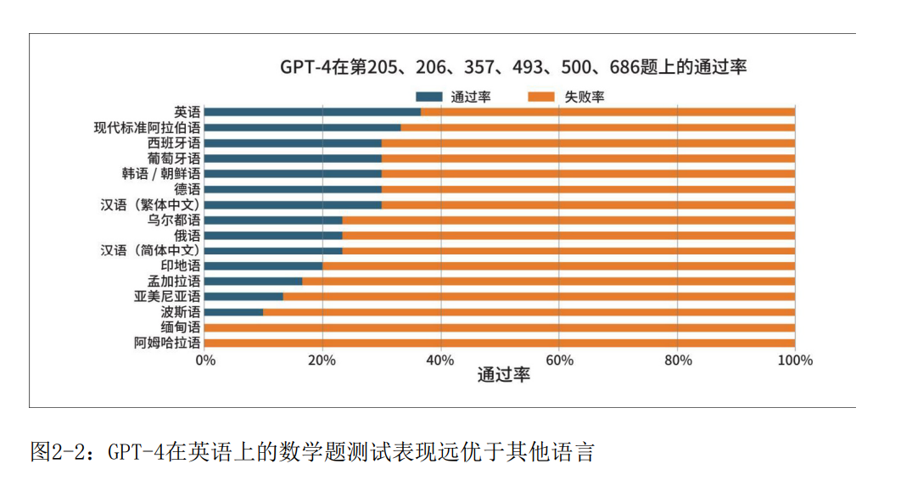

# 第二章：理解基础模型

> 重点关注那些对下游应用产生重要影响的设计决策。
> 本章节探讨了有助于确定使用哪些模型以及如何使用这些模型的建模因素。
> 影响模型性能的一个关键因素是训练数据。当特定任务的数据缺少的时候就需要开发特定领域模型。
> 数据就绪后，就需要进行一个重要步骤——模型架构设计。本章节探讨了模型架构与规模等建模选择。语言类基础模型的主流架构是 Transformer。
> 衡量模型的规模有三个关键指标：参数量，训练token数以及FLOPs。

要基于基础模型构建应用，首先得了解模型本身。

随着基础模型训练过程越来越不透明，我们很难了解构建模型时的全部设计决策。
然而，总体而言，基础模型之间的差异主要源于训练数据、模型架构和规模，以及
通过后训练使其与人类偏好对齐等方面的决策。

由于模型从数据中学习，因此训练数据在很大程度上决定了模型的能力和局限性。
本章首先介绍模型开发者如何选择训练数据，重点关注训练数据的分布。第8章将
详细探讨数据集工程技术，包括数据质量评估和数据合成。

鉴于Transformer架构的主导地位，模型架构的选择空间似乎非常有限。你可能会
好奇，Transformer架构究竟有什么特别之处，使其能够持续占据主导地位？还要
多久才会出现替代架构？这种新架构可能是什么样的？本章将回答这些问题。此
外，每当新模型发布时，人们首先关注的往往是它的规模。本章还将探讨模型开发
者如何确定模型的规模。

如第1章所述，模型的训练过程通常分为预训练和后训练。预训练赋予模型一定的
能力，但并不意味着模型就安全或易用。这正是后训练的用武之地。后训练的目标
是实现模型与人类偏好的对齐。但究竟什么是人类偏好？如何将其转化为模型能够
学习的形式？模型开发者如何实现这种对齐，将极大地影响模型的可用性，本章将
对此进行讨论。

虽然大多数人都理解训练对模型性能的影响，但采样的使用却常被忽视。采样是模
型从所有可能的选项中生成输出的过程，这可能是AI领域最被低估的概念之一。采
样解释了许多看似令人困惑的AI行为（包括幻觉和不一致性），而且选择合适的采
样策略还能以相对较小的代价显著提升模型性能。因此，采样是本章的重点内容。

# 2.1 训练数据

AI模型的表现取决于其训练数据的质量。如果训练数据中不包含越南语内容，模型
就无法将英语翻译成越南语。同样，如果图像分类模型的训练集中只有动物图片，
那么它在识别植物图片时的表现就不会理想。

Common Crawl（在一定程度上也包括C4）的数据质量存疑——其中充斥着标题党、
虚假信息、政治宣传、阴谋论、种族主义、厌女言论，以及各种你在网上见过或避
之唯恐不及的可疑网站。《华盛顿邮报》的一项研究显示，在该数据集中最常见的
1000个网站中，部分媒体在NewsGuard的可信度评分（参见NewsGuard网站的“News
Reliability Ratings”）中排名较低（参见“Inside the secret list of
websites that make AI like ChatGPT sound smart”）。通俗地说，Common
Crawl中包含了大量的假新闻。

这种“使用现有数据，而非理想数据”的方法可能导致模型在训练数据覆盖的任务
上表现良好，但未必能在你真正关注的任务上表现出色。为了解决这个问题，精心
选择符合特定需求的数据集至关重要。本节重点介绍如何为特定语言和领域选择数
据，从而为该范围内的应用奠定广泛而专业的基础。第8章将探讨针对特定任务的
模型的数据策略。

## 2.1.1 多语言模型

表现不佳的一个重要原因是数据代表性不足。在GPT-4的MMLU基准测试中表现最差
的3种语言——泰卢固语、马拉地语和旁遮普语——也恰恰是Common Crawl数据集
中代表性不足最为突出的语言。然而，代表性不足并非唯一原因，语言的结构及其
所体现的文化差异也可能增加模型学习该语言的难度。

既然LLM通常擅长翻译，我们是否可以将所有非英语语言的查询翻译成英语，获取
回答后再翻译回原语言呢？许多人确实采用了这种方法，但它并不理想。首先，这
种方法要求模型能够充分理解代表性不足的语言，才能进行准确的翻译。其次，翻
译过程可能导致信息丢失。例如，越南语中有专门的代词来表示两个说话者之间的
关系，但在翻译成英文时，这些代词通常会变成I和you，导致关系信息的丢失。

为了解决这一问题，许多模型专门针对非英语语言进行了训练。除英语模型之外，
目前最活跃的无疑是中文模型，例如ChatGLM、YAYI、Llama-Chinese等。此外，还
有法语模型CroissantLLM、越南语模型PhoGPT、阿拉伯语模型Jais等许多其他语言
的模型。

## 2.1.2 领域特定模型

